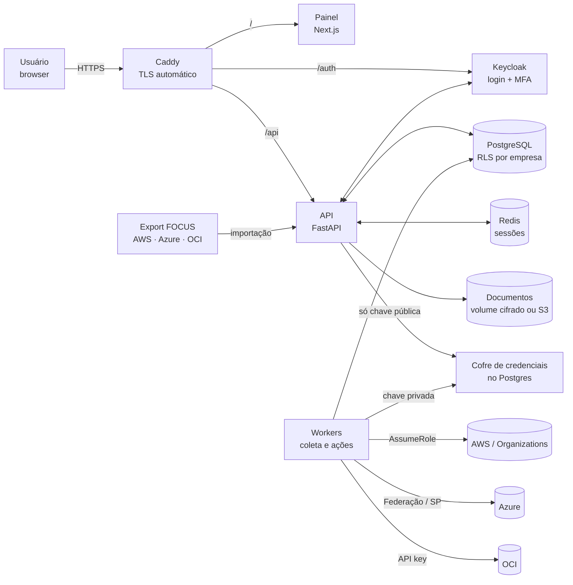
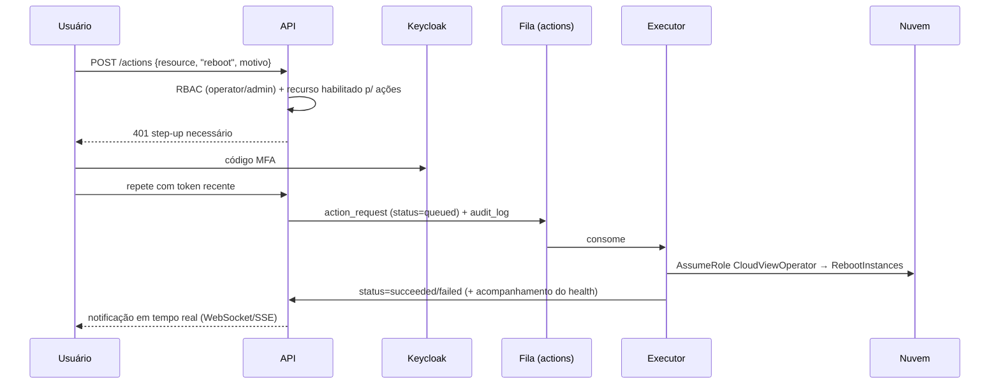

# Cloud View — Arquitetura da Solução

Painel multi-cloud (AWS, Azure, OCI) e multi-cliente com custos, otimização, saúde,
rede, inventário, ações rápidas, alertas, atualizações e recomendações.

---

## 1. Princípios

| Princípio | Como é atendido |
|---|---|
| **Painel rápido** | O front **nunca** consulta as nuvens em tempo real. Coletores assíncronos gravam *snapshots* normalizados no Postgres e o painel lê do banco/cache (respostas < 200 ms). Eventos (mudança de estado, Health) chegam por *push*. |
| **Segurança das credenciais** | Preferência por **credenciais sem chave** (AssumeRole com ExternalId, federação OIDC). Quando houver segredo, ele vai para o **cofre próprio** (RSA-4096 + AES-256-GCM): a API só tem a chave pública (grava, não lê) e só os workers têm a privada. Segredos são *write-only* na UI. |
| **Menor privilégio** | Dois papéis por conta: `CloudViewReadOnly` (coleta) e `CloudViewOperator` (ações, restrito por tag). |
| **Multi-tenant** | Cada linha de custo e cada documento tem `tenant_id`, calculado pelas regras de atribuição de contas; Row-Level Security no Postgres. Uma Organization pode ter contas de várias empresas. |
| **Infra enxuta e portátil** | Um `docker compose` roda a stack inteira, igual na máquina local e em uma VM de AWS, Azure ou OCI. Nada depende de serviço gerenciado de uma nuvem. |
| **Extensível** | Cada provedor é um *plugin* com a mesma interface (`inventory`, `costs`, `health`, `recommendations`, `actions`). |

---

## 2. Visão geral



Tudo roda em containers numa única máquina (ou mais, se precisar crescer). Só o Caddy publica
portas (80/443).

---

## 3. Stack

| Camada | Tecnologia | Motivo |
|---|---|---|
| Entrada | **Caddy** | HTTPS automático (Let's Encrypt), um único domínio para painel, API e login |
| Frontend | **Next.js (React) + TypeScript** | Tabelas e gráficos rápidos |
| API | **Python 3.12 + FastAPI**, SQLAlchemy 2, Pydantic | SDKs oficiais mais completos das 3 nuvens são em Python |
| Workers | Python, fila e agendador no **Postgres** (`FOR UPDATE SKIP LOCKED`) | Sem serviço de fila de nuvem; vários workers em paralelo |
| Identidade | **Keycloak** (OIDC) — senha + **TOTP** obrigatório | MFA, política de senha, bloqueio por força bruta, convites por e-mail |
| Banco | **PostgreSQL 16** (container, ou gerenciado se preferir) | Relacional + custos diários; particionamento por mês quando crescer |
| Cache / sessões | **Redis** | Sessões server-side, cache de KPIs |
| Custos | Formato **FOCUS** (FinOps) | Mesmo layout exportado por AWS, Azure e OCI |
| Segredos | **Cofre próprio** (RSA-4096 + AES-256-GCM) | Portável; API grava sem conseguir ler |
| Documentos | Volume Docker cifrado (AES-256-GCM) ou qualquer **S3 compatível** | AWS S3, MinIO, OCI Object Storage, Cloudflare R2 |
| Backup | `pg_dump` diário (14 dias) em volume | Copiar o volume para fora da máquina |
| CI | GitHub Actions | Testes, build e subida da stack completa |

Alternativa opcional: `infra/optional/aws-ecs` (Terraform com ECS Fargate, RDS, ElastiCache, ALB/WAF).

---

## 4. Modelo de dados (multi-cliente)

```
Empresa (tenant)  ←──  papéis por usuário: tenant_admin | operator | finance | viewer
   ▲
   │ regras de atribuição (conta inteira, ou só linhas com uma tag; com período de validade)
   │
Conta de nuvem (conta AWS / subscription Azure / compartment OCI)
   │ pertence hoje a →  Conexão (Organization / conta pagadora / tenant Azure / tenancy OCI)
   │
   └── linhas de custo diárias (FOCUS) ── tenant_id calculado pela atribuição
Documentos (invoice, NF-e, boleto, demonstrativo) ── sempre de UMA empresa
```

Ponto central: **a conexão (Organization/pagadora) não pertence a uma empresa**. Uma mesma
Organization "AB" pode ter contas das empresas A e B; e a empresa A pode ter contas em AB, AC e AD.
Quem vê o quê é decidido conta a conta.

Tabelas principais:

```sql
tenant(id, name, slug, aws_external_id)
app_user(id, keycloak_sub, email, name, disabled, invited_at, last_login_at)
user_tenant_role(user_id, tenant_id, role)            -- role ∈ tenant_admin|operator|finance|viewer
connection(id, provider, kind, native_id, name, secret_ref)
cloud_account(id, provider, native_id, name, connection_id)
account_assignment(id, cloud_account_id, tenant_id, tag_key, tag_value, valid_from, valid_to)
cost_line(id, tenant_id, cloud_account_id, provider, billing_account_id, charge_date,
          service, region, charge_category, currency, billed_cost, effective_cost, tags jsonb)
import_batch(id, filename, period_start, period_end, source_rows, stored_rows, replaced_rows)
document(id, tenant_id, kind, billing_period, number, amount, currency, due_date,
         filename, content_type, sha256, storage_key)
cloud_secret(id, purpose, key_id, sealed)             -- credencial cifrada pelo cofre
audit_log(...)                                         -- append-only
```

Isolamento: RLS em `tenant`, `cost_line` e `document` com
`tenant_id = ANY(current_setting('app.tenant_ids'))`, definido pela API a cada request.
Detalhes do modelo de acesso: [ACESSOS-E-FATURAMENTO.md](ACESSOS-E-FATURAMENTO.md).

---

## 5. Autenticação, MFA e autorização

1. **Login** no Keycloak (realm `cloudview`): usuário + senha (Argon2/PBKDF2 alto custo,
   política de complexidade, bloqueio após N tentativas).
2. **MFA obrigatório** (*Required Action*: Configure OTP / WebAuthn) — Google/Microsoft
   Authenticator ou Passkey/YubiKey.
3. Fluxo **OIDC Authorization Code + PKCE**; o token fica no backend (padrão BFF) e o browser
   recebe apenas cookie `HttpOnly; Secure; SameSite=Strict`. Sessão curta (15 min) com refresh.
4. **Step-up MFA** para ações sensíveis (reiniciar, parar, cadastrar credencial): a API exige
   `acr`/`auth_time` recente (< 5 min), forçando novo código MFA.
5. **RBAC por cliente**:

| Papel | Ver dados | Ações rápidas | Gerenciar conexões/credenciais | Usuários |
|---|---|---|---|---|
| `admin` | todos | ✅ | ✅ | ✅ |
| `operator` | clientes atribuídos | ✅ | ❌ | ❌ |
| `viewer` | clientes atribuídos | ❌ | ❌ | ❌ |
| `client` (portal do cliente) | só o próprio tenant | opcional | ❌ | ❌ |

6. Opcional: SSO corporativo (Entra ID / Google) federado no Keycloak, IP allowlist no WAF.

---

## 6. Credenciais das nuvens — como guardar com segurança

### 6.1 AWS (sem chave de acesso!)

Os workers usam **uma única identidade "hub"** para assumir roles nas contas dos clientes:
- se a VM roda na AWS (EC2), a *instance profile* da máquina — nenhuma chave guardada;
- em qualquer outro lugar (Azure, OCI, local), um usuário IAM `cloudview-hub` cuja única permissão
  é `sts:AssumeRole` em `CloudViewReadOnly`/`CloudViewOperator`; a chave dele fica no cofre.

Em cada conta cliente é criada (via CloudFormation de 1 clique ou **StackSet** na Organization) a role:

```yaml
# cloudview-readonly.yaml (resumo)
Resources:
  CloudViewReadOnly:
    Type: AWS::IAM::Role
    Properties:
      RoleName: CloudViewReadOnly
      AssumeRolePolicyDocument:
        Statement:
          - Effect: Allow
            Principal: { AWS: arn:aws:iam::<HUB_ACCOUNT_ID>:role/cloudview-worker }
            Action: sts:AssumeRole
            Condition: { StringEquals: { sts:ExternalId: <EXTERNAL_ID_POR_CLIENTE> } }
      ManagedPolicyArns:
        - arn:aws:iam::aws:policy/ReadOnlyAccess          # ou policy enxuta
        - arn:aws:iam::aws:policy/AWSBillingReadOnlyAccess
  CloudViewOperator:
    Type: AWS::IAM::Role   # mesma trust policy, assumida só pelo executor de ações
    Properties:
      Policies:
        - PolicyName: quick-actions
          PolicyDocument:
            Statement:
              - Effect: Allow
                Action: [ec2:RebootInstances, ec2:StartInstances, ec2:StopInstances,
                         ssm:SendCommand, ecs:UpdateService, rds:RebootDBInstance]
                Resource: "*"
                Condition: { StringEquals: { aws:ResourceTag/cloudview-actions: "enabled" } }
```

- **Organizations**: cadastra-se a role da conta *management* (ou de uma conta *delegated
  admin*); o coletor chama `organizations:ListAccounts` e assume a role em cada conta-membro
  (instalada via StackSet com auto-deployment → contas novas entram sozinhas).
- Nada de access key armazenada. O `ExternalId` é único por cliente (evita *confused deputy*).

### 6.2 Azure

- App Registration **multi-tenant** da plataforma; o cliente faz *admin consent* e atribui
  `Reader` + `Cost Management Reader` (+ `Virtual Machine Contributor` customizado só para
  restart, se quiser ações) no Management Group/Subscriptions.
- Autenticação preferencial: **Workload Identity Federation** (credencial federada confiando
  no token OIDC da plataforma) → sem segredo. Alternativa: **certificado** guardado no
  cofre. *Client secret* só em último caso, com rotação.

### 6.3 OCI

- Usuário técnico (ou grupo) com policies `inspect/read all-resources`, `read usage-reports`,
  e `use instance-family` (para ações) restrito a compartments.
- **API Signing Key**: o par de chaves é **gerado pela própria plataforma**; só a chave pública
  é mostrada para o cliente colar no console OCI. A privada vai direto para o cofre
  e nunca trafega/aparece de novo.

### 6.4 Regras gerais de segredos

- **Cofre próprio, portátil** (`apps/api/app/vault.py`): cada segredo é cifrado com uma chave
  AES-256-GCM aleatória, que por sua vez é cifrada com a chave pública RSA-4096 do cofre.
  O texto cifrado fica no Postgres (`cloud_secret`), amarrado ao próprio id (não pode ser copiado
  para outra conexão).
- A **API só monta a chave pública**: grava credenciais novas, mas não lê as existentes. Só os
  workers montam a chave privada (volume Docker separado).
- Rotação: gera-se um novo par; os workers aceitam várias chaves privadas, então segredos antigos
  continuam legíveis até serem regravados.
- Campos de segredo são *write-only* na UI/API; o banco da aplicação não guarda nada em claro.
- Credenciais temporárias (STS/Azure tokens) ficam só em memória, com TTL ≤ 1 h.
- Documentos (invoices/NF) cifrados no disco com AES-256-GCM, ou em S3 compatível.

---

## 7. Coletores — o que buscar em cada nuvem

| Domínio | AWS | Azure | OCI | Frequência |
|---|---|---|---|---|
| **Inventário / modelo da instância** | EC2/RDS/ECS/Lambda/EBS `Describe*`, **Resource Explorer**, Config | **Azure Resource Graph** (1 query p/ tudo) | **Search Service**, Compute/DB APIs | 15 min + eventos |
| **Rede** | VPC, Subnets, SG, ENI, EIP, NAT, ELB, TGW, Route 53, VPN | VNet, NSG, Public IP, LB, App GW, VPN/ER | VCN, Subnets, Security Lists/NSG, LB, DRG | 1 h |
| **Saúde de instâncias** | EC2 Status Checks, CloudWatch (CPU, StatusCheckFailed, rede, disco via agent) | Resource Health, Azure Monitor metrics | Monitoring (oci_computeagent), Instance status | 5 min |
| **Saúde de serviços** | **AWS Health API** (visão organizacional) + EventBridge | Service Health (Activity Log) | Announcements / Status | 5 min + push |
| **Custos / pagamento** | Cost Explorer (diário, por serviço/conta/tag, forecast), **CUR 2.0 / Data Exports + Athena**, Budgets, Invoices | Cost Management Query, Consumption, Invoices (Billing) | Usage API, Cost Reports, Budgets, Invoices | 6–12 h (Cost Explorer cobra US$0,01/req → cache) |
| **Cost optimization** | **Cost Optimization Hub**, Compute Optimizer, Trusted Advisor, SP/RI recommendations e cobertura | **Azure Advisor** (Cost), Reservations recommendations | **Cloud Advisor** | diário |
| **Atualizações / patches** | **SSM Patch Manager** compliance, AMIs antigas, versões de engine RDS/EKS em fim de suporte | **Azure Update Manager** | **OS Management Hub** | diário |
| **Segurança (dicas)** | Security Hub, GuardDuty findings, IAM Access Analyzer | Defender for Cloud secure score | Cloud Guard | diário |

**Regras próprias de recomendação** (independem de advisor pago):
- EBS `gp2` → `gp3` (~20% mais barato); volumes/discos não anexados; snapshots > 90 dias.
- Elastic/Public IPs ociosos; Load Balancers sem targets; NAT Gateway com pouco tráfego.
- Instâncias com CPU p95 < 10% por 14 dias → *rightsizing*; famílias de geração antiga
  (m4, t2, c4 → m7g/t4g/c7g); instâncias paradas há > 30 dias com disco cobrando.
- Recursos de dev ligados 24/7 → agendamento liga/desliga.
- SG/NSG com `0.0.0.0/0` em 22/3389; recursos sem tags obrigatórias (`owner`, `env`).
- Baixa cobertura de Savings Plans/Reservas.

Cada recomendação traz **economia estimada/mês**, esforço e botão “aplicar” quando aplicável.

### Estratégia de performance da coleta
- Fila por *(conexão, região, domínio)* → paralelismo alto, isolando falhas.
- *Lock* em Redis para não coletar a mesma conta em duplicidade.
- Backoff exponencial para *throttling*; DLQ + alerta de “conexão quebrada”.
- Diferencial: grava só o que mudou (hash do `raw`), mantém histórico.
- Agregados pré-calculados (*materialized views* atualizadas pelo pg_cron) para os KPIs.

---

## 8. Ações rápidas

Fluxo de execução (ex.: reiniciar EC2/VM):



Ações iniciais: reiniciar / ligar / desligar VM, reboot RDS/DB, *force new deployment* ECS,
rodar comando SSM pré-aprovado (ex.: reiniciar serviço), criar snapshot antes de ação.
Proteções: confirmação digitando o nome do recurso, tag `cloudview-actions=enabled`,
janela de bloqueio para produção, aprovação dupla opcional, **auditoria imutável**.

---

## 9. Alertas e notificações

- **Fontes**: eventos push (EventBridge cross-account → bus central; Azure Event Grid;
  OCI Events → Notifications HTTPS), resultados dos coletores, detecção de anomalia.
- **Tipos de regra**: orçamento (% consumido / forecast estourando), **anomalia de custo**
  (AWS Cost Anomaly Detection + z-score próprio sobre `cost_daily`), instância com status
  check falhando, CPU/disco alto, evento AWS Health agendado (manutenção/retirement),
  certificado expirando, patch crítico pendente, conexão sem sincronizar, novo recurso
  público exposto.
- **Canais**: e-mail (SES), Microsoft Teams, Slack, Telegram/WhatsApp (via provedor),
  webhook genérico, PagerDuty/Opsgenie.
- Deduplicação, agrupamento, silenciar/ack, escalonamento, resumo diário/semanal por cliente.

---

## 10. Telas do painel

1. **Visão geral global** — gasto do mês vs. mês anterior vs. forecast por cliente e nuvem,
   alertas abertos, saúde (verde/amarelo/vermelho), economia potencial total.
2. **Cliente** — contas/subscriptions/tenancies, custo por serviço/conta/tag, faturas e status
   de pagamento, orçamento.
3. **Inventário** — tabela única multi-cloud: nome, nuvem, conta, região, tipo/modelo
   (vCPU/RAM), SO, estado, IPs privado/público, VPC/subnet, SG, tags, custo/mês, CPU p95;
   filtros salvos e exportação CSV. Botões de ação na linha.
4. **Recurso (detalhe)** — métricas, rede, eventos, patches, recomendações, histórico de ações.
5. **Saúde** — eventos de serviço por região/nuvem, manutenções agendadas.
6. **Otimização** — recomendações ranqueadas por economia, status (aberta/aceita/ignorada).
7. **Rede** — topologia VPC/VNet/VCN (grafo), exposição pública.
8. **Atualizações** — compliance de patches e versões em fim de suporte.
9. **Alertas** e **Regras**.
10. **Administração** — clientes, conexões (assistente de onboarding com CloudFormation/
    script Azure/OCI gerados), usuários e papéis, auditoria.

Busca global (Ctrl+K) por nome, IP, ID de instância.

---

## 11. Infraestrutura da plataforma

Uma VM com Docker, em qualquer nuvem ou no seu datacenter:

```
Internet ──► Caddy :80/:443 (TLS automático)
               ├── /        → web (Next.js)
               ├── /api/*   → api (FastAPI)
               └── /auth/*  → keycloak     (console /auth/admin só de redes liberadas)
Rede interna Docker: postgres · redis · migrate · vault-keys · backup · worker · worker-actions
Volumes: pgdata · documents (cifrado) · vault-private · vault-public · backups · caddy-data
```

| Porte | Sugestão de VM | Custo aproximado |
|---|---|---|
| Até ~100 contas | 2 vCPU / 4–8 GB (AWS t4g.large, Azure B2s, OCI Ampere A1) | US$ 0–60/mês (OCI A1 cabe no *Always Free*) |
| Até ~500 contas | 4 vCPU / 16 GB | US$ 60–150/mês |

Crescendo: Postgres e Redis podem sair para serviços gerenciados só trocando as URLs no `.env`,
e os documentos para S3 compatível. Passo a passo em [DEPLOY.md](DEPLOY.md).

---

## 12. Estrutura do repositório

```
cloud-view/
├── docker-compose.yml       # stack completa (local e servidor)
├── scripts/setup.sh         # gera .env com segredos aleatórios
├── apps/
│   ├── web/                 # Next.js
│   └── api/                 # FastAPI: auth, RBAC, custos, relatórios, documentos, cofre
├── infra/
│   ├── caddy/Caddyfile
│   ├── keycloak/            # realm (MFA obrigatório) e imagem
│   ├── local/               # init do Postgres
│   └── optional/aws-ecs/    # Terraform opcional (ECS/RDS/ALB)
├── onboarding/aws/          # CloudFormation das roles (conta ou Organization)
├── samples/                 # arquivo FOCUS de exemplo
└── docs/
```

---

## 13. Roadmap sugerido

| Fase | Entrega | Prazo estimado* |
|---|---|---|
| **0 – Fundação** ✅ | Keycloak com MFA obrigatório, RBAC, empresas, auditoria imutável, RLS | 2–3 semanas |
| **0.5 – Acessos e faturamento** ✅ | Administração de usuários (convite, desativar, reset de MFA), papéis por empresa, atribuição de contas (inclusive dividida por tag), importação FOCUS das 3 nuvens, relatórios por conta/serviço/tag com CSV, invoices e notas fiscais, cofre portátil, stack Docker única | 2–3 semanas |
| **1 – Coleta AWS** ✅ | Conexões AWS / Organizations, coleta automática de custos (Cost Explorer ou FOCUS no S3) e invoices, inventário + rede, saúde, ações rápidas — ver [FASE-1.md](FASE-1.md) | 4–6 semanas |
| **2 – Otimização e alertas** ✅ | Cost Optimization Hub + regras próprias, cobertura de Savings Plans, orçamentos, anomalias, alertas e notificações (e-mail/Slack/Teams/webhook), patches SSM — ver [FASE-2.md](FASE-2.md) | 3–4 semanas |
| **3 – Azure** ✅ | App hub multi-tenant, coleta automática (Cost Management ou FOCUS no Blob, Resource Graph), Advisor, Resource Health e Service Health, ações em VM — ver [FASE-3.md](FASE-3.md) | 3–4 semanas |
| **4 – OCI** | Coleta automática (FOCUS reports, Search), Cloud Advisor, Monitoring, ações em instância | 3–4 semanas |
| **5 – Evolução** | Topologia de rede, relatório mensal em PDF, agendamento liga/desliga | contínuo |

\* para 1–2 desenvolvedores full-stack.

---

## 14. Decisões e alternativas

- **Keycloak vs. auth próprio vs. Cognito**: Keycloak dá MFA/WebAuthn/brute-force/auditoria
  prontos e é portável. Cognito é mais simples de operar, porém menos flexível em fluxos de
  step-up. Auth próprio só se o requisito for mínimo (argon2id + TOTP RFC 6238).
- **Python vs. Go/Node no backend**: Python pela maturidade dos SDKs das três nuvens; os
  workers podem ser reescritos em Go depois, se o volume exigir.
- **Ferramentas prontas** (para comparação): CloudHealth, Spot/Flexera, Vantage, CAST AI —
  pagas por % do gasto; o projeto próprio compensa ao gerenciar muitos clientes com ações
  operacionais e marca própria.
