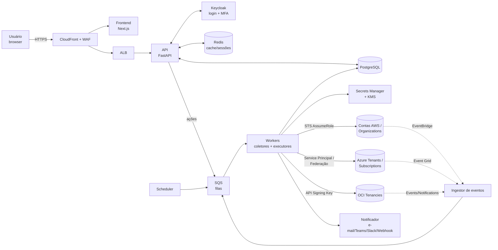

# Cloud View — Arquitetura da Solução

Painel multi-cloud (AWS, Azure, OCI) e multi-cliente com custos, otimização, saúde,
rede, inventário, ações rápidas, alertas, atualizações e recomendações.

---

## 1. Princípios

| Princípio | Como é atendido |
|---|---|
| **Painel rápido** | O front **nunca** consulta as nuvens em tempo real. Coletores assíncronos gravam *snapshots* normalizados no Postgres e o painel lê do banco/cache (respostas < 200 ms). Eventos (mudança de estado, Health) chegam por *push*. |
| **Segurança das credenciais** | Preferência por **credenciais sem chave** (AssumeRole com ExternalId, federação OIDC). Quando houver segredo (OCI API key, Azure secret), ele fica no **AWS Secrets Manager criptografado com KMS CMK**; o banco guarda só a referência (ARN). Segredos são *write-only* na UI. |
| **Menor privilégio** | Dois papéis por conta: `CloudViewReadOnly` (coleta) e `CloudViewOperator` (ações, restrito por tag). |
| **Multi-tenant** | Toda entidade tem `tenant_id` (cliente) + Row-Level Security no Postgres. |
| **Extensível** | Cada provedor é um *plugin* com a mesma interface (`inventory`, `costs`, `health`, `recommendations`, `actions`). |

---

## 2. Visão geral



---

## 3. Stack recomendada

| Camada | Tecnologia | Motivo |
|---|---|---|
| Frontend | **Next.js (React) + TypeScript**, Tailwind + shadcn/ui, TanStack Query/Table, ECharts | Tabelas grandes, gráficos rápidos, SSR para primeira carga |
| API | **Python 3.12 + FastAPI**, SQLAlchemy 2, Pydantic | SDKs oficiais mais completos das 3 nuvens são em Python (boto3, azure-sdk, oci) |
| Workers | Python (mesmo código-base), **SQS** como fila, Celery ou Dramatiq | Paralelismo por conta/região, retries, DLQ |
| Identidade | **Keycloak** (OIDC) — senha + **TOTP** e/ou **WebAuthn/Passkey** obrigatórios | MFA, política de senha, bloqueio por força bruta, auditoria prontos |
| Banco | **PostgreSQL 16** (RDS Multi-AZ) com tabelas particionadas por mês (**pg_partman**) para métricas e custo diário | Relacional + séries temporais num só lugar (o RDS não oferece TimescaleDB) |
| Cache | **Redis** (ElastiCache) | KPIs do dashboard, rate limit, locks de coleta |
| Segredos | **AWS Secrets Manager + KMS CMK** (alternativa: HashiCorp Vault) | Rotação, auditoria no CloudTrail, envelope encryption |
| Hospedagem | **AWS ECS Fargate**, ALB, CloudFront, WAF | Sem gerenciar servidores; conta “hub” isolada |
| IaC / CI | **Terraform** + GitHub Actions com OIDC (sem chaves no CI) | Reprodutível |
| Observabilidade | OpenTelemetry → CloudWatch / Grafana | Monitorar os próprios coletores |

---

## 4. Modelo de dados (multi-cliente)

```
Cliente (tenant)
 └── Conexão (provider + tipo)
      ├── aws_account          → 1 conta
      ├── aws_organization     → descobre N contas automaticamente
      ├── azure_tenant         → descobre N subscriptions
      └── oci_tenancy          → descobre N compartments
           └── Conta/Subscription/Compartment (cloud_account)
                └── Recurso (resource) — instâncias, discos, IPs, LBs, VNets…
                     ├── métricas (resource_metric, série temporal)
                     ├── eventos de saúde (health_event)
                     └── recomendações (recommendation)
```

Tabelas principais:

```sql
tenant(id, name, slug, created_at)
connection(id, tenant_id, provider, kind, display_name,
           auth_method,           -- assume_role | federated | service_principal | api_key
           role_arn, external_id, -- AWS
           azure_tenant_id, client_id,
           oci_tenancy_ocid, oci_user_ocid, oci_fingerprint,
           secret_ref,            -- ARN no Secrets Manager (NUNCA o segredo)
           status, last_sync_at)
cloud_account(id, tenant_id, connection_id, provider, native_id, name, tags jsonb)
resource(id, tenant_id, cloud_account_id, provider, region, type, native_id, name,
         state, instance_model, vcpu, memory_gb, os,
         private_ips, public_ips, vpc_id, subnet_id, security_groups jsonb,
         tags jsonb, raw jsonb, collected_at)
cost_daily(tenant_id, cloud_account_id, day, service, region, amount, currency, -- particionada por mês
           amortized_amount, usage_type)
cost_forecast(tenant_id, cloud_account_id, month, amount)
invoice(tenant_id, cloud_account_id, period, amount, status, due_date)
resource_metric(resource_id, ts, metric, value)          -- particionada (CPU, mem, rede)
health_event(id, tenant_id, provider, scope, service, region, status, start, end, details)
recommendation(id, tenant_id, resource_id, source, category, -- cost|performance|security|reliability
               title, description, estimated_monthly_saving, effort, status)
patch_status(resource_id, missing_critical, missing_security, last_scan)
alert_rule(id, tenant_id, type, condition jsonb, channels jsonb, enabled)
alert(id, tenant_id, rule_id, severity, title, resource_id, status, opened_at, closed_at)
action_request(id, tenant_id, user_id, resource_id, action, status, reason,
               requested_at, executed_at, result jsonb)
audit_log(id, ts, user_id, tenant_id, ip, action, target, payload_hash)  -- append-only
app_user(id, keycloak_sub, email)   user_tenant_role(user_id, tenant_id, role)
```

Isolamento: `ALTER TABLE ... ENABLE ROW LEVEL SECURITY` com política
`tenant_id = current_setting('app.tenant_ids')`, definida pela API a cada request
a partir dos tenants do usuário autenticado.

---

## 5. Autenticação, MFA e autorização

1. **Login** no Keycloak (realm `cloudview`): usuário + senha (Argon2/PBKDF2 alto custo,
   política de complexidade, bloqueio após N tentativas).
2. **MFA obrigatório** (*Required Action*: Configure OTP / WebAuthn) — Google/Microsoft
   Authenticator ou Passkey/YubiKey.
3. Fluxo **OIDC Authorization Code + PKCE**; o token fica no backend (padrão BFF) e o browser
   recebe apenas cookie `HttpOnly; Secure; SameSite=Strict`. Sessão curta (15 min) com refresh.
4. **Step-up MFA** para ações sensíveis (reiniciar, parar, cadastrar credencial): a API exige
   `acr`/`auth_time` recente (< 5 min), forçando novo código MFA.
5. **RBAC por cliente**:

| Papel | Ver dados | Ações rápidas | Gerenciar conexões/credenciais | Usuários |
|---|---|---|---|---|
| `admin` | todos | ✅ | ✅ | ✅ |
| `operator` | clientes atribuídos | ✅ | ❌ | ❌ |
| `viewer` | clientes atribuídos | ❌ | ❌ | ❌ |
| `client` (portal do cliente) | só o próprio tenant | opcional | ❌ | ❌ |

6. Opcional: SSO corporativo (Entra ID / Google) federado no Keycloak, IP allowlist no WAF.

---

## 6. Credenciais das nuvens — como guardar com segurança

### 6.1 AWS (sem chave de acesso!)

A plataforma roda numa **conta hub** com uma IAM Role da task ECS. Em cada conta cliente
é criada (via CloudFormation de 1 clique ou **StackSet** na Organization) a role:

```yaml
# cloudview-readonly.yaml (resumo)
Resources:
  CloudViewReadOnly:
    Type: AWS::IAM::Role
    Properties:
      RoleName: CloudViewReadOnly
      AssumeRolePolicyDocument:
        Statement:
          - Effect: Allow
            Principal: { AWS: arn:aws:iam::<HUB_ACCOUNT_ID>:role/cloudview-worker }
            Action: sts:AssumeRole
            Condition: { StringEquals: { sts:ExternalId: <EXTERNAL_ID_POR_CLIENTE> } }
      ManagedPolicyArns:
        - arn:aws:iam::aws:policy/ReadOnlyAccess          # ou policy enxuta
        - arn:aws:iam::aws:policy/AWSBillingReadOnlyAccess
  CloudViewOperator:
    Type: AWS::IAM::Role   # mesma trust policy, assumida só pelo executor de ações
    Properties:
      Policies:
        - PolicyName: quick-actions
          PolicyDocument:
            Statement:
              - Effect: Allow
                Action: [ec2:RebootInstances, ec2:StartInstances, ec2:StopInstances,
                         ssm:SendCommand, ecs:UpdateService, rds:RebootDBInstance]
                Resource: "*"
                Condition: { StringEquals: { aws:ResourceTag/cloudview-actions: "enabled" } }
```

- **Organizations**: cadastra-se a role da conta *management* (ou de uma conta *delegated
  admin*); o coletor chama `organizations:ListAccounts` e assume a role em cada conta-membro
  (instalada via StackSet com auto-deployment → contas novas entram sozinhas).
- Nada de access key armazenada. O `ExternalId` é único por cliente (evita *confused deputy*).

### 6.2 Azure

- App Registration **multi-tenant** da plataforma; o cliente faz *admin consent* e atribui
  `Reader` + `Cost Management Reader` (+ `Virtual Machine Contributor` customizado só para
  restart, se quiser ações) no Management Group/Subscriptions.
- Autenticação preferencial: **Workload Identity Federation** (credencial federada confiando
  no token OIDC da plataforma) → sem segredo. Alternativa: **certificado** guardado no
  Secrets Manager. *Client secret* só em último caso, com rotação.

### 6.3 OCI

- Usuário técnico (ou grupo) com policies `inspect/read all-resources`, `read usage-reports`,
  e `use instance-family` (para ações) restrito a compartments.
- **API Signing Key**: o par de chaves é **gerado pela própria plataforma**; só a chave pública
  é mostrada para o cliente colar no console OCI. A privada vai direto para o Secrets Manager
  e nunca trafega/aparece de novo.

### 6.4 Regras gerais de segredos

- Secrets Manager com **KMS CMK dedicada** e *key policy* que só permite `Decrypt` à role dos
  workers (a API web **não** consegue ler segredos).
- Banco guarda apenas `secret_ref`. Campos de segredo são *write-only* na UI/API.
- Credenciais temporárias (STS/Azure tokens) ficam só em memória, com TTL ≤ 1 h.
- Rotação agendada, CloudTrail + alerta para qualquer `GetSecretValue` fora dos workers.
- Banco criptografado (RDS + KMS), TLS em tudo, backups criptografados.

---

## 7. Coletores — o que buscar em cada nuvem

| Domínio | AWS | Azure | OCI | Frequência |
|---|---|---|---|---|
| **Inventário / modelo da instância** | EC2/RDS/ECS/Lambda/EBS `Describe*`, **Resource Explorer**, Config | **Azure Resource Graph** (1 query p/ tudo) | **Search Service**, Compute/DB APIs | 15 min + eventos |
| **Rede** | VPC, Subnets, SG, ENI, EIP, NAT, ELB, TGW, Route 53, VPN | VNet, NSG, Public IP, LB, App GW, VPN/ER | VCN, Subnets, Security Lists/NSG, LB, DRG | 1 h |
| **Saúde de instâncias** | EC2 Status Checks, CloudWatch (CPU, StatusCheckFailed, rede, disco via agent) | Resource Health, Azure Monitor metrics | Monitoring (oci_computeagent), Instance status | 5 min |
| **Saúde de serviços** | **AWS Health API** (visão organizacional) + EventBridge | Service Health (Activity Log) | Announcements / Status | 5 min + push |
| **Custos / pagamento** | Cost Explorer (diário, por serviço/conta/tag, forecast), **CUR 2.0 / Data Exports + Athena**, Budgets, Invoices | Cost Management Query, Consumption, Invoices (Billing) | Usage API, Cost Reports, Budgets, Invoices | 6–12 h (Cost Explorer cobra US$0,01/req → cache) |
| **Cost optimization** | **Cost Optimization Hub**, Compute Optimizer, Trusted Advisor, SP/RI recommendations e cobertura | **Azure Advisor** (Cost), Reservations recommendations | **Cloud Advisor** | diário |
| **Atualizações / patches** | **SSM Patch Manager** compliance, AMIs antigas, versões de engine RDS/EKS em fim de suporte | **Azure Update Manager** | **OS Management Hub** | diário |
| **Segurança (dicas)** | Security Hub, GuardDuty findings, IAM Access Analyzer | Defender for Cloud secure score | Cloud Guard | diário |

**Regras próprias de recomendação** (independem de advisor pago):
- EBS `gp2` → `gp3` (~20% mais barato); volumes/discos não anexados; snapshots > 90 dias.
- Elastic/Public IPs ociosos; Load Balancers sem targets; NAT Gateway com pouco tráfego.
- Instâncias com CPU p95 < 10% por 14 dias → *rightsizing*; famílias de geração antiga
  (m4, t2, c4 → m7g/t4g/c7g); instâncias paradas há > 30 dias com disco cobrando.
- Recursos de dev ligados 24/7 → agendamento liga/desliga.
- SG/NSG com `0.0.0.0/0` em 22/3389; recursos sem tags obrigatórias (`owner`, `env`).
- Baixa cobertura de Savings Plans/Reservas.

Cada recomendação traz **economia estimada/mês**, esforço e botão “aplicar” quando aplicável.

### Estratégia de performance da coleta
- Fila por *(conexão, região, domínio)* → paralelismo alto, isolando falhas.
- *Lock* em Redis para não coletar a mesma conta em duplicidade.
- Backoff exponencial para *throttling*; DLQ + alerta de “conexão quebrada”.
- Diferencial: grava só o que mudou (hash do `raw`), mantém histórico.
- Agregados pré-calculados (*materialized views* atualizadas pelo pg_cron) para os KPIs.

---

## 8. Ações rápidas

Fluxo de execução (ex.: reiniciar EC2/VM):


Ações iniciais: reiniciar / ligar / desligar VM, reboot RDS/DB, *force new deployment* ECS,
rodar comando SSM pré-aprovado (ex.: reiniciar serviço), criar snapshot antes de ação.
Proteções: confirmação digitando o nome do recurso, tag `cloudview-actions=enabled`,
janela de bloqueio para produção, aprovação dupla opcional, **auditoria imutável**.

---

## 9. Alertas e notificações

- **Fontes**: eventos push (EventBridge cross-account → bus central; Azure Event Grid;
  OCI Events → Notifications HTTPS), resultados dos coletores, detecção de anomalia.
- **Tipos de regra**: orçamento (% consumido / forecast estourando), **anomalia de custo**
  (AWS Cost Anomaly Detection + z-score próprio sobre `cost_daily`), instância com status
  check falhando, CPU/disco alto, evento AWS Health agendado (manutenção/retirement),
  certificado expirando, patch crítico pendente, conexão sem sincronizar, novo recurso
  público exposto.
- **Canais**: e-mail (SES), Microsoft Teams, Slack, Telegram/WhatsApp (via provedor),
  webhook genérico, PagerDuty/Opsgenie.
- Deduplicação, agrupamento, silenciar/ack, escalonamento, resumo diário/semanal por cliente.

---

## 10. Telas do painel

1. **Visão geral global** — gasto do mês vs. mês anterior vs. forecast por cliente e nuvem,
   alertas abertos, saúde (verde/amarelo/vermelho), economia potencial total.
2. **Cliente** — contas/subscriptions/tenancies, custo por serviço/conta/tag, faturas e status
   de pagamento, orçamento.
3. **Inventário** — tabela única multi-cloud: nome, nuvem, conta, região, tipo/modelo
   (vCPU/RAM), SO, estado, IPs privado/público, VPC/subnet, SG, tags, custo/mês, CPU p95;
   filtros salvos e exportação CSV. Botões de ação na linha.
4. **Recurso (detalhe)** — métricas, rede, eventos, patches, recomendações, histórico de ações.
5. **Saúde** — eventos de serviço por região/nuvem, manutenções agendadas.
6. **Otimização** — recomendações ranqueadas por economia, status (aberta/aceita/ignorada).
7. **Rede** — topologia VPC/VNet/VCN (grafo), exposição pública.
8. **Atualizações** — compliance de patches e versões em fim de suporte.
9. **Alertas** e **Regras**.
10. **Administração** — clientes, conexões (assistente de onboarding com CloudFormation/
    script Azure/OCI gerados), usuários e papéis, auditoria.

Busca global (Ctrl+K) por nome, IP, ID de instância.

---

## 11. Infraestrutura da plataforma (conta AWS hub)

```
Route 53 → ALB (+ WAF: rate limit, IP allowlist, managed rules)   [CloudFront opcional na frente]
   └── ALB (subnets públicas) → ECS Fargate (subnets privadas)
          ├── web/BFF (2+ tasks)
          ├── api (2+ tasks, autoscaling)
          ├── workers-collect (autoscaling por profundidade de fila)
          ├── workers-actions (isolado, única role que assume CloudViewOperator)
          ├── scheduler (1 task)
          └── keycloak (2 tasks, banco próprio)
   RDS PostgreSQL Multi-AZ · ElastiCache Redis · SQS (+DLQ) · Secrets Manager · KMS
   EventBridge (bus central recebendo eventos das contas clientes)
   SES · CloudWatch/Grafana · AWS Backup · GuardDuty/Security Hub na própria conta
```

Separação de privilégios por *task role*: a API não lê segredos; só `workers-actions`
pode assumir roles de escrita.

**Custo estimado** (porte inicial, até ~100 contas): ~US$ 250–450/mês
(Fargate ~120, RDS Multi-AZ db.t4g.medium ~130, Redis ~30, ALB/CloudFront/WAF ~50,
Secrets/KMS/SQS ~20) + chamadas de Cost Explorer (~US$ 0,01 cada).

---

## 12. Estrutura do repositório

```
cloud-view/
├── apps/
│   ├── web/                 # Next.js
│   └── api/                 # FastAPI (rotas, auth, RBAC, BFF)
├── workers/
│   ├── core/                # fila, scheduler, locks, normalização
│   ├── providers/
│   │   ├── aws/             # inventory.py costs.py health.py recommendations.py actions.py
│   │   ├── azure/
│   │   └── oci/
│   ├── rules/               # regras próprias de recomendação e alertas
│   └── notifiers/           # email, teams, slack, webhook
├── db/migrations/           # Alembic
├── infra/terraform/         # plataforma (hub)
├── onboarding/
│   ├── aws/cloudformation/  # roles ReadOnly/Operator + StackSet p/ Organization
│   ├── azure/               # script az cli / Bicep de RBAC
│   └── oci/                 # policies IAM
└── docs/
```

Interface comum de provedor:

```python
class CloudProvider(Protocol):
    def discover_accounts(self, conn: Connection) -> list[CloudAccount]: ...
    def collect_inventory(self, acc: CloudAccount, region: str) -> Iterable[Resource]: ...
    def collect_costs(self, acc: CloudAccount, start: date, end: date) -> Iterable[CostRow]: ...
    def collect_health(self, acc: CloudAccount) -> Iterable[HealthEvent]: ...
    def collect_recommendations(self, acc: CloudAccount) -> Iterable[Recommendation]: ...
    def execute_action(self, res: Resource, action: ActionType) -> ActionResult: ...
```

---

## 13. Roadmap sugerido

| Fase | Entrega | Prazo estimado* |
|---|---|---|
| **0 – Fundação** | Terraform da conta hub, Keycloak com MFA obrigatório, RBAC, tenants, auditoria | 2–3 semanas |
| **1 – MVP AWS** | Onboarding por CloudFormation (conta e Organization), inventário + rede, custos diários/forecast, saúde EC2 + AWS Health, dashboard geral, reiniciar/ligar/desligar | 4–6 semanas |
| **2 – Otimização e alertas** | Cost Optimization Hub/Compute Optimizer + regras próprias, orçamentos, anomalias, notificações Teams/Slack/e-mail, patches SSM | 3–4 semanas |
| **3 – Azure** | Resource Graph, Cost Management, Advisor, Resource Health, ações em VM | 3–4 semanas |
| **4 – OCI** | Search, Usage API, Cloud Advisor, Monitoring, ações em instância | 3–4 semanas |
| **5 – Evolução** | Portal do cliente, topologia de rede, relatórios PDF mensais, agendamento liga/desliga, showback por tag | contínuo |

\* para 1–2 desenvolvedores full-stack.

---

## 14. Decisões e alternativas

- **Keycloak vs. auth próprio vs. Cognito**: Keycloak dá MFA/WebAuthn/brute-force/auditoria
  prontos e é portável. Cognito é mais simples de operar, porém menos flexível em fluxos de
  step-up. Auth próprio só se o requisito for mínimo (argon2id + TOTP RFC 6238).
- **Python vs. Go/Node no backend**: Python pela maturidade dos SDKs das três nuvens; os
  workers podem ser reescritos em Go depois, se o volume exigir.
- **Ferramentas prontas** (para comparação): CloudHealth, Spot/Flexera, Vantage, CAST AI —
  pagas por % do gasto; o projeto próprio compensa ao gerenciar muitos clientes com ações
  operacionais e marca própria.
